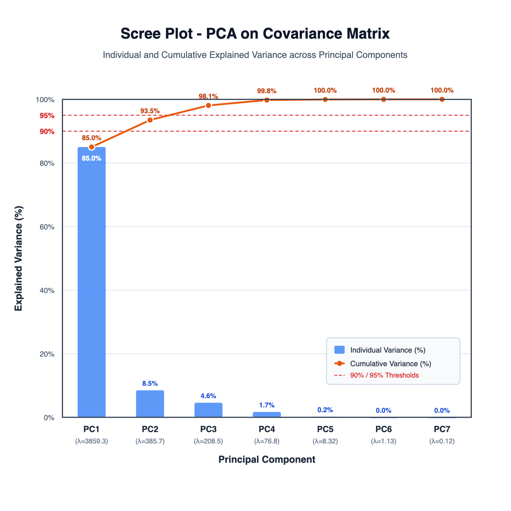
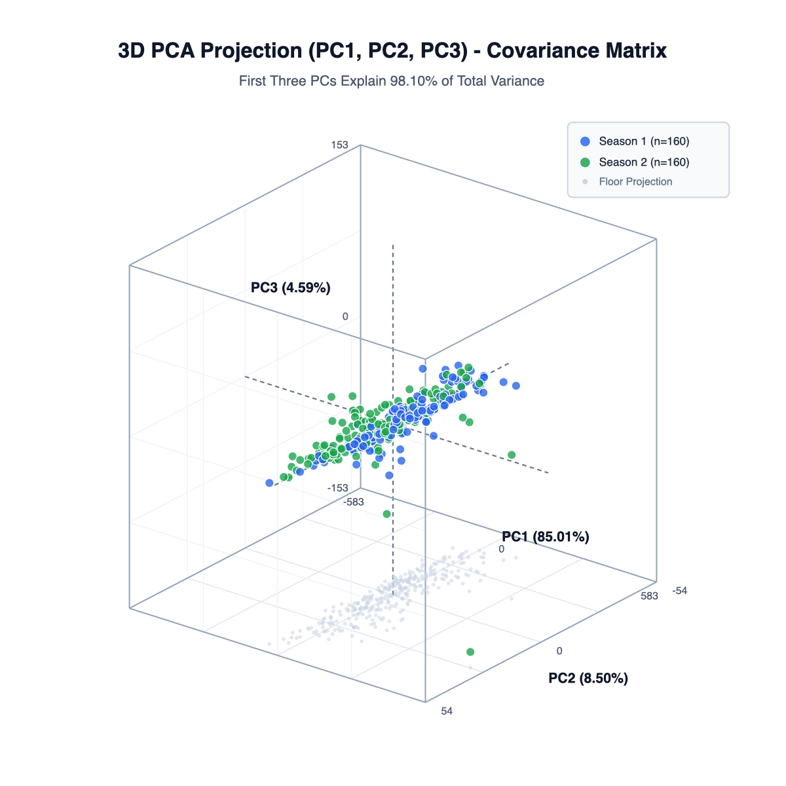
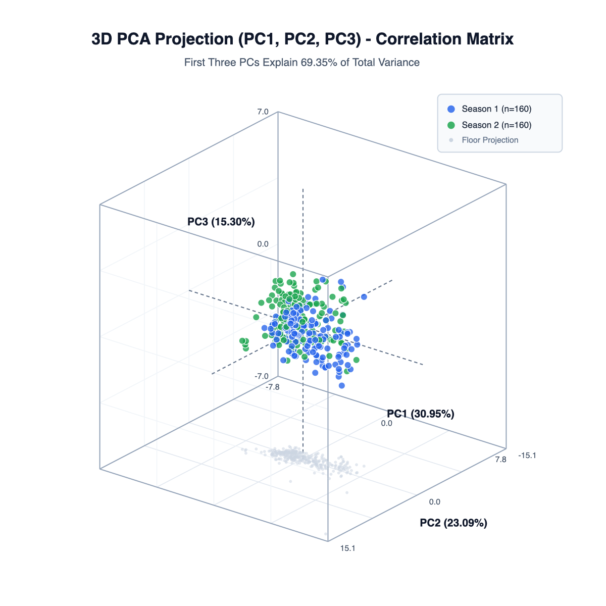

# Report 2: Dimension Reduction Methods – Principal Component Analysis (PCA)

## 1. Introduction and Dataset Description

Principal Component Analysis (PCA) is a dimension reduction technique that transforms a set of correlated variables into a smaller set of uncorrelated linear combinations called **Principal Components (PCs)**. The goal of PCA is to capture as much of the original data variability as possible using the fewest components.

In this report, we analyze the **Forty Soybean Cultivars from Subsequent Harvests** dataset (`n = 320` observations across 40 cultivars, 2 seasons, and 4 repetitions). Following the assignment instructions, the target variable **Grain Yield (`GY`)** and the experimental identifiers (`Season`, `Cultivar`, `Repetition`) are omitted. The analysis is performed on the **7 continuous agronomic features**:

| Feature | Full Name / Description | Mean ($\bar{x}$) | Std. Dev. ($s$) | Variance ($s^2$) |
| :--- | :--- | ---: | ---: | ---: |
| **PH** | Plant Height (cm) | 68.3868 | 8.9582 | 80.2492 |
| **IFP** | Insertion of the First Pod (cm) | 15.4650 | 3.0243 | 9.1464 |
| **NLP** | Number of Pods (Legumes) per Plant | 59.0883 | 20.0682 | 402.7321 |
| **NGP** | Number of Grains per Plant | 135.0858 | 60.4945 | 3659.5880 |
| **NGL** | Number of Grains per Pod (Legume) | 2.2908 | 0.8401 | 0.7058 |
| **NS** | Number of Stems (Branches) | 4.0717 | 1.4745 | 2.1742 |
| **MHG** | Mass of a Hundred Grains (g) | 168.3223 | 19.6256 | 385.1628 |

We perform two separate PCA analyses:
1. **PCA on the Covariance Matrix** (using mean-centered variables $X' = X - \bar{X}$).
2. **PCA on the Correlation Matrix** (using standardized variables $X^* = \frac{X - \bar{X}}{s}$).

---

## 2. Quick Answers to Assignment Questions

- **How many principal components should be used to account for 90%, 95%, and 99% of variability?**
  - **a) Covariance Matrix PCA:**
    - **90% variability:** **2 PCs** (accounts for **93.51%**)
    - **95% variability:** **3 PCs** (accounts for **98.10%**)
    - **99% variability:** **4 PCs** (accounts for **99.79%**)
  - **b) Correlation Matrix PCA:**
    - **90% variability:** **5 PCs** (accounts for **94.97%**)
    - **95% variability:** **6 PCs** (accounts for **99.35%**)
    - **99% variability:** **6 PCs** (accounts for **99.35%**)
- **What percentage of variability is accounted for by the first two and first three principal components?**
  - **Covariance Matrix PCA:** First two PCs = **93.51%**; First three PCs = **98.10%**.
  - **Correlation Matrix PCA:** First two PCs = **54.04%**; First three PCs = **69.35%**.

---

## 3. Part A: Principal Component Analysis Using the Covariance Matrix

### 3.1 Covariance Matrix

In covariance-based PCA, variables remain in their original measurement units. Because `NGP` (variance = $3659.59$), `NLP` ($402.73$), and `MHG` ($385.16$) have much larger numeric scales than `NGL` ($0.71$) or `NS` ($2.17$), the total variance ($\sum s_i^2 = 4539.76$) is heavily dominated by `NGP`.

| | PH | IFP | NLP | NGP | NGL | NS | MHG |
| :--- | ---: | ---: | ---: | ---: | ---: | ---: | ---: |
| **PH** | 80.2492 | 8.8150 | 31.0538 | 34.3979 | -0.6168 | -0.6437 | -8.1959 |
| **IFP** | 8.8150 | 9.1464 | 3.2219 | -10.5057 | -0.3852 | 1.5356 | -4.2214 |
| **NLP** | 31.0538 | 3.2219 | 402.7321 | 827.7090 | -1.0474 | 15.4437 | -0.2707 |
| **NGP** | 34.3979 | -10.5057 | 827.7090 | 3659.5880 | 31.5865 | 32.0854 | 38.0931 |
| **NGL** | -0.6168 | -0.3852 | -1.0474 | 31.5865 | 0.7058 | -0.0911 | 0.8508 |
| **NS** | -0.6437 | 1.5356 | 15.4437 | 32.0854 | -0.0911 | 2.1742 | -3.7404 |
| **MHG** | -8.1959 | -4.2214 | -0.2707 | 38.0931 | 0.8508 | -3.7404 | 385.1628 |

### 3.2 Eigenvalues Table (Covariance Matrix)

| Principal Component | Eigenvalue ($\lambda_k$) | Explained Variance (%) | Cumulative Variance (%) |
| :--- | ---: | ---: | ---: |
| **PC1** | 3859.2795 | 85.01% | 85.01% |
| **PC2** | 385.6580 | 8.50% | 93.51% |
| **PC3** | 208.4685 | 4.59% | 98.10% |
| **PC4** | 76.7777 | 1.69% | 99.79% |
| **PC5** | 8.3209 | 0.18% | 99.97% |
| **PC6** | 1.1348 | 0.02% | 100.00% |
| **PC7** | 0.1193 | 0.00% | 100.00% |
| **Total** | **4539.7587** | **100.00%** | — |

- **Number of components required:**
  - **a) 90% variability:** **2 components** (`PC1` + `PC2` = **93.51%**)
  - **b) 95% variability:** **3 components** (`PC1` to `PC3` = **98.10%**)
  - **c) 99% variability:** **4 components** (`PC1` to `PC4` = **99.79%**)
- **Variability accounted for by first 2 and first 3 PCs:**
  - First 2 PCs: **93.51%**
  - First 3 PCs: **98.10%**

### 3.3 Scree Plot (Covariance Matrix)

### 3.4 Eigenvectors and Factor Loadings (Covariance Matrix)

Below are both the **eigenvectors** $e_{ik}$ (the linear combination weights used in the PC equations) and the **factor loadings** $L_{ik} = \text{Corr}(X_i, PC_k) = \frac{e_{ik}\sqrt{\lambda_k}}{s_i}$ (which measure the correlation between each original feature and each principal component):

#### Eigenvectors (Component Weights $e_{ik}$)

| Variable | PC1 | PC2 | PC3 | PC4 | PC5 | PC6 | PC7 |
| :--- | ---: | ---: | ---: | ---: | ---: | ---: | ---: |
| **PH** | 0.0107 | -0.0325 | 0.1676 | 0.9780 | -0.1090 | 0.0485 | 0.0010 |
| **IFP** | -0.0024 | -0.0126 | 0.0341 | 0.1126 | 0.9676 | -0.2232 | 0.0022 |
| **NLP** | 0.2330 | -0.0561 | 0.9544 | -0.1687 | -0.0229 | -0.0376 | 0.0364 |
| **NGP** | 0.9723 | 0.0030 | -0.2311 | 0.0299 | 0.0070 | -0.0009 | -0.0172 |
| **NGL** | 0.0079 | 0.0027 | -0.0403 | 0.0065 | -0.0096 | -0.0349 | 0.9985 |
| **NS** | 0.0090 | -0.0117 | 0.0342 | -0.0294 | 0.2262 | 0.9722 | 0.0377 |
| **MHG** | 0.0106 | 0.9977 | 0.0608 | 0.0233 | 0.0100 | 0.0082 | -0.0001 |

#### Factor Loadings (Variable–Component Correlations $L_{ik}$)

| Variable | PC1 | PC2 | PC3 | PC4 | PC5 | PC6 | PC7 |
| :--- | ---: | ---: | ---: | ---: | ---: | ---: | ---: |
| **PH** | 0.0744 | -0.0712 | 0.2702 | **0.9566** | -0.0351 | 0.0058 | 0.0000 |
| **IFP** | -0.0502 | -0.0816 | 0.1627 | 0.3263 | **0.9229** | -0.0786 | 0.0002 |
| **NLP** | **0.7211** | -0.0549 | **0.6867** | -0.0737 | -0.0033 | -0.0020 | 0.0006 |
| **NGP** | **0.9985** | 0.0010 | -0.0552 | 0.0043 | 0.0003 | 0.0000 | -0.0001 |
| **NGL** | **0.5839** | 0.0624 | **-0.6921** | 0.0680 | -0.0330 | -0.0443 | 0.4104 |
| **NS** | 0.3795 | -0.1564 | 0.3344 | -0.1746 | 0.4425 | **0.7024** | 0.0088 |
| **MHG** | 0.0336 | **0.9984** | 0.0447 | 0.0104 | 0.0015 | 0.0004 | 0.0000 |

### 3.5 Mathematical Representation of the First Three PCs (Covariance Matrix)

Let $X'_i = X_i - \bar{X}_i$ denote the mean-centered variables. The equations for the first three principal components are:

$$
\text{PC}_1 = 0.0107\,\text{PH}' - 0.0024\,\text{IFP}' + 0.2330\,\text{NLP}' + 0.9723\,\text{NGP}' + 0.0079\,\text{NGL}' + 0.0090\,\text{NS}' + 0.0106\,\text{MHG}'
$$

$$
\text{PC}_2 = -0.0325\,\text{PH}' - 0.0126\,\text{IFP}' - 0.0561\,\text{NLP}' + 0.0030\,\text{NGP}' + 0.0027\,\text{NGL}' - 0.0117\,\text{NS}' + 0.9977\,\text{MHG}'
$$

$$
\text{PC}_3 = 0.1676\,\text{PH}' + 0.0341\,\text{IFP}' + 0.9544\,\text{NLP}' - 0.2311\,\text{NGP}' - 0.0403\,\text{NGL}' + 0.0342\,\text{NS}' + 0.0608\,\text{MHG}'
$$

### 3.6 2D and 3D Principal Component Plots (Covariance Matrix)

### 3.7 Description and Interpretation (Covariance Matrix PCA)

1. **Dominance of High-Variance Variables:** Because the variables are not standardized, `NGP` (Number of Grains per Plant) accounts for $3659.59 / 4539.76 = 80.6\%$ of the raw variance in the dataset. Consequently, **PC1 (85.01% of variance)** is almost entirely aligned with `NGP` (weight $= 0.9723$, correlation loading $= 0.9985$) along with its strongly correlated partner `NLP` (weight $= 0.2330$, loading $= 0.7211$).
2. **PC2 (8.50% of variance):** Almost purely represents **MHG** (Mass of 100 Grains), with an eigenvector weight of $0.9977$ and a factor loading of $0.9984$. As seen in the 2D biplot, the `MHG` arrow points vertically along the PC2 axis, perpendicular to `NGP` and `NLP`.
3. **PC3 (4.59% of variance):** Captures the residual contrast between `NLP` (Number of Pods, weight $= +0.9544$, loading $= +0.6867$) and `NGP` / `NGL` (Grains per Pod, loading $= -0.6921$).
4. **Limitation:** Variables with small numerical scales (`NGL`, `NS`, `IFP`) have almost zero weight in the first three components simply because their units of measurement produce small numbers, not because they are biologically unimportant.

---

## 4. Part B: Principal Component Analysis Using the Correlation Matrix

### 4.1 Correlation Matrix

Standardizing each variable to zero mean and unit variance ($s_i^2 = 1$) gives every feature an equal weight of $1.0$ (total variance $= 7.0$). This reveals scale-independent relationships among the soybean traits.

| | PH | IFP | NLP | NGP | NGL | NS | MHG |
| :--- | ---: | ---: | ---: | ---: | ---: | ---: | ---: |
| **PH** | 1.0000 | 0.3254 | 0.1727 | 0.0635 | -0.0820 | -0.0487 | -0.0466 |
| **IFP** | 0.3254 | 1.0000 | 0.0531 | -0.0574 | -0.1516 | 0.3444 | -0.0711 |
| **NLP** | 0.1727 | 0.0531 | 1.0000 | 0.6818 | -0.0621 | 0.5219 | -0.0007 |
| **NGP** | 0.0635 | -0.0574 | 0.6818 | 1.0000 | 0.6215 | 0.3597 | 0.0321 |
| **NGL** | -0.0820 | -0.1516 | -0.0621 | 0.6215 | 1.0000 | -0.0736 | 0.0516 |
| **NS** | -0.0487 | 0.3444 | 0.5219 | 0.3597 | -0.0736 | 1.0000 | -0.1293 |
| **MHG** | -0.0466 | -0.0711 | -0.0007 | 0.0321 | 0.0516 | -0.1293 | 1.0000 |

### 4.2 Eigenvalues Table (Correlation Matrix)

| Principal Component | Eigenvalue ($\lambda_k$) | Explained Variance (%) | Cumulative Variance (%) |
| :--- | ---: | ---: | ---: |
| **PC1** | 2.1666 | 30.95% | 30.95% |
| **PC2** | 1.6165 | 23.09% | 54.04% |
| **PC3** | 1.0712 | 15.30% | 69.35% |
| **PC4** | 0.9789 | 13.98% | 83.33% |
| **PC5** | 0.8147 | 11.64% | 94.97% |
| **PC6** | 0.3063 | 4.38% | 99.35% |
| **PC7** | 0.0458 | 0.65% | 100.00% |
| **Total** | **7.0000** | **100.00%** | — |

- **Number of components required:**
  - **a) 90% variability:** **5 components** (`PC1` to `PC5` = **94.97%**)
  - **b) 95% variability:** **6 components** (`PC1` to `PC6` = **99.35%**)
  - **c) 99% variability:** **6 components** (`PC1` to `PC6` = **99.35%**)
- **Variability accounted for by first 2 and first 3 PCs:**
  - First 2 PCs: **54.04%**
  - First 3 PCs: **69.35%**
- *(Note: Under the Kaiser criterion $\lambda_k > 1$, the first **3 components** are retained, with `PC4` right on the boundary at $\lambda_4 = 0.9789$.)*

### 4.3 Scree Plot (Correlation Matrix)

### 4.4 Eigenvectors and Factor Loadings (Correlation Matrix)

For standardized variables, the factor loadings are given by $L_{ik} = e_{ik}\sqrt{\lambda_k}$:

#### Eigenvectors (Component Weights $e_{ik}$)

| Variable | PC1 | PC2 | PC3 | PC4 | PC5 | PC6 | PC7 |
| :--- | ---: | ---: | ---: | ---: | ---: | ---: | ---: |
| **PH** | 0.1227 | -0.3560 | 0.7421 | -0.0686 | -0.3849 | 0.3932 | 0.0080 |
| **IFP** | 0.1412 | -0.5538 | 0.2700 | -0.0669 | 0.6209 | -0.4587 | -0.0053 |
| **NLP** | 0.5733 | -0.0990 | -0.1316 | 0.2479 | -0.4127 | -0.3701 | -0.5248 |
| **NGP** | 0.6016 | 0.3192 | 0.1175 | -0.0569 | -0.0366 | -0.1805 | 0.6966 |
| **NGL** | 0.2317 | 0.5682 | 0.3275 | -0.3465 | 0.3717 | 0.1373 | -0.4889 |
| **NS** | 0.4682 | -0.2919 | -0.4052 | 0.0538 | 0.3032 | 0.6607 | -0.0107 |
| **MHG** | -0.0389 | 0.2163 | 0.2718 | 0.8962 | 0.2542 | 0.1003 | 0.0012 |

#### Factor Loadings (Variable–Component Correlations $L_{ik}$)

| Variable | PC1 | PC2 | PC3 | PC4 | PC5 | PC6 | PC7 |
| :--- | ---: | ---: | ---: | ---: | ---: | ---: | ---: |
| **PH** | 0.1806 | -0.4526 | **0.7680** | -0.0679 | -0.3474 | 0.2176 | 0.0017 |
| **IFP** | 0.2078 | **-0.7042** | 0.2794 | -0.0662 | **0.5604** | -0.2539 | -0.0011 |
| **NLP** | **0.8439** | -0.1259 | -0.1362 | 0.2452 | -0.3725 | -0.2049 | -0.1123 |
| **NGP** | **0.8854** | 0.4059 | 0.1216 | -0.0563 | -0.0330 | -0.0999 | 0.1490 |
| **NGL** | 0.3411 | **0.7224** | 0.3389 | -0.3429 | 0.3355 | 0.0760 | -0.1046 |
| **NS** | **0.6892** | -0.3711 | -0.4194 | 0.0532 | 0.2736 | 0.3657 | -0.0023 |
| **MHG** | -0.0573 | 0.2750 | 0.2813 | **0.8867** | 0.2295 | 0.0555 | 0.0003 |

### 4.5 Mathematical Representation of the First Three PCs (Correlation Matrix)

Let $X^*_i = \frac{X_i - \bar{X}_i}{s_i}$ denote the standardized (z-score) variables. The equations for the first three principal components are:

$$
\text{PC}_1 = 0.1227\,\text{PH}^* + 0.1412\,\text{IFP}^* + 0.5733\,\text{NLP}^* + 0.6016\,\text{NGP}^* + 0.2317\,\text{NGL}^* + 0.4682\,\text{NS}^* - 0.0389\,\text{MHG}^*
$$

$$
\text{PC}_2 = -0.3560\,\text{PH}^* - 0.5538\,\text{IFP}^* - 0.0990\,\text{NLP}^* + 0.3192\,\text{NGP}^* + 0.5682\,\text{NGL}^* - 0.2919\,\text{NS}^* + 0.2163\,\text{MHG}^*
$$

$$
\text{PC}_3 = 0.7421\,\text{PH}^* + 0.2700\,\text{IFP}^* - 0.1316\,\text{NLP}^* + 0.1175\,\text{NGP}^* + 0.3275\,\text{NGL}^* - 0.4052\,\text{NS}^* + 0.2718\,\text{MHG}^*
$$

### 4.6 2D and 3D Principal Component Plots (Correlation Matrix)

### 4.7 Description and Interpretation (Correlation Matrix PCA)

1. **PC1 – Overall Plant Reproductive Capacity (30.95% of variance):**
   - Strongly and positively correlated with `NGP` (loading $= 0.8854$), `NLP` (loading $= 0.8439$), and `NS` (loading $= 0.6892$).
   - Cultivars with high PC1 scores produce more stems/branches, more pods per plant, and more total grains per plant. Notice in the 2D plot that **Season 1** (blue points) tends to have higher positive scores on PC1 than **Season 2** (green points), reflecting higher branching and pod production in Season 1.
2. **PC2 – Pod Filling Efficiency vs. Structural Height (23.09% of variance):**
   - Shows a strong positive loading for `NGL` (Grains per Pod, $0.7224$) and `NGP` ($0.4059$), contrasted against negative loadings for `IFP` (First Pod Insertion Height, $-0.7042$), `PH` (Plant Height, $-0.4526$), and `NS` ($-0.3711$).
   - This component separates compact plants with many grains per pod (high PC2) from taller, high-insertion plants with fewer grains per pod (low PC2).
3. **PC3 – Vegetative Plant Stature vs. Branching (15.30% of variance):**
   - Dominated by `PH` (Plant Height, loading $= +0.7680$) opposed to `NS` (Number of Stems, loading $= -0.4194$). It distinguishes tall, single-stem architectures from shorter, bushy architectures.
4. **PC4 – Seed Weight Factor (13.98% of variance):**
   - Dominated by `MHG` (Mass of 100 Grains, loading $= +0.8867$). Because `MHG` is almost completely uncorrelated with the other 6 traits ($|r| \le 0.13$ in the correlation matrix), it forms its own nearly independent dimension.
5. **Near-Zero Last Component (PC7 = 0.65%):**
   - Since $\text{NGP} \approx \text{NLP} \times \text{NGL}$, the logarithm or linear approximation of `NGP` is nearly a linear combination of `NLP` and `NGL`. That collinearity explains why `PC7` has an eigenvalue near zero ($\lambda_7 = 0.0458$) and why 6 components already capture **99.35%** of the variance.

---

## 5. Comparison and Final Conclusions

| Criterion | a) Covariance Matrix PCA | b) Correlation Matrix PCA |
| :--- | :--- | :--- |
| **Input Variables** | Centered ($X - \bar{X}$), original units | Standardized ($(X - \bar{X})/s$), unit-free |
| **Variance of First 2 PCs** | **93.51%** (PC1: 85.01%, PC2: 8.50%) | **54.04%** (PC1: 30.95%, PC2: 23.09%) |
| **Variance of First 3 PCs** | **98.10%** (+ PC3: 4.59%) | **69.35%** (+ PC3: 15.30%) |
| **PCs for $\ge 90\%$ Variance** | **2 PCs** (93.51%) | **5 PCs** (94.97%) |
| **PCs for $\ge 95\%$ Variance** | **3 PCs** (98.10%) | **6 PCs** (99.35%) |
| **PCs for $\ge 99\%$ Variance** | **4 PCs** (99.79%) | **6 PCs** (99.35%) |
| **Main Drivers of PC1** | `NGP` ($r=0.999$) due to large numerical scale | `NGP` ($r=0.885$), `NLP` ($r=0.844$), `NS` ($r=0.689$) |

### Main Conclusions

1. **Why the Two Methods Give Different Results:**
   The dataset contains variables measured in incompatible units and scales: `NGP` ranges up to hundreds of grains ($s^2 = 3659.59$), `NLP` and `MHG` have variances around $400$, whereas `NGL` ($s^2 = 0.71$) and `NS` ($s^2 = 2.17$) have very small numerical variances. In **Covariance PCA**, the first three components simply sort the three largest-scale variables (`NGP` $\rightarrow$ `MHG` $\rightarrow$ `NLP`) and ignore small-scale variables.
2. **Which Method is Better for This Dataset:**
   **Correlation Matrix PCA is the appropriate method** for this dataset. Because the 7 features have different physical units (centimeters, counts, ratios, and grams), standardizing the features ensures that all traits contribute equally to the analysis.
3. **Agronomic Insight from Correlation PCA:**
   Correlation PCA uncovers four clear biological dimensions of soybean architecture:
   - **PC1 (30.95%):** Reproductive volume (pods, grains, and stems per plant).
   - **PC2 (23.09%):** Pod fertility (`NGL`) vs. pod insertion height (`IFP`).
   - **PC3 (15.30%):** Plant height (`PH`) vs. stem branching (`NS`).
   - **PC4 (13.98%):** Individual seed weight (`MHG`), which varies independently of pod and stem counts.
