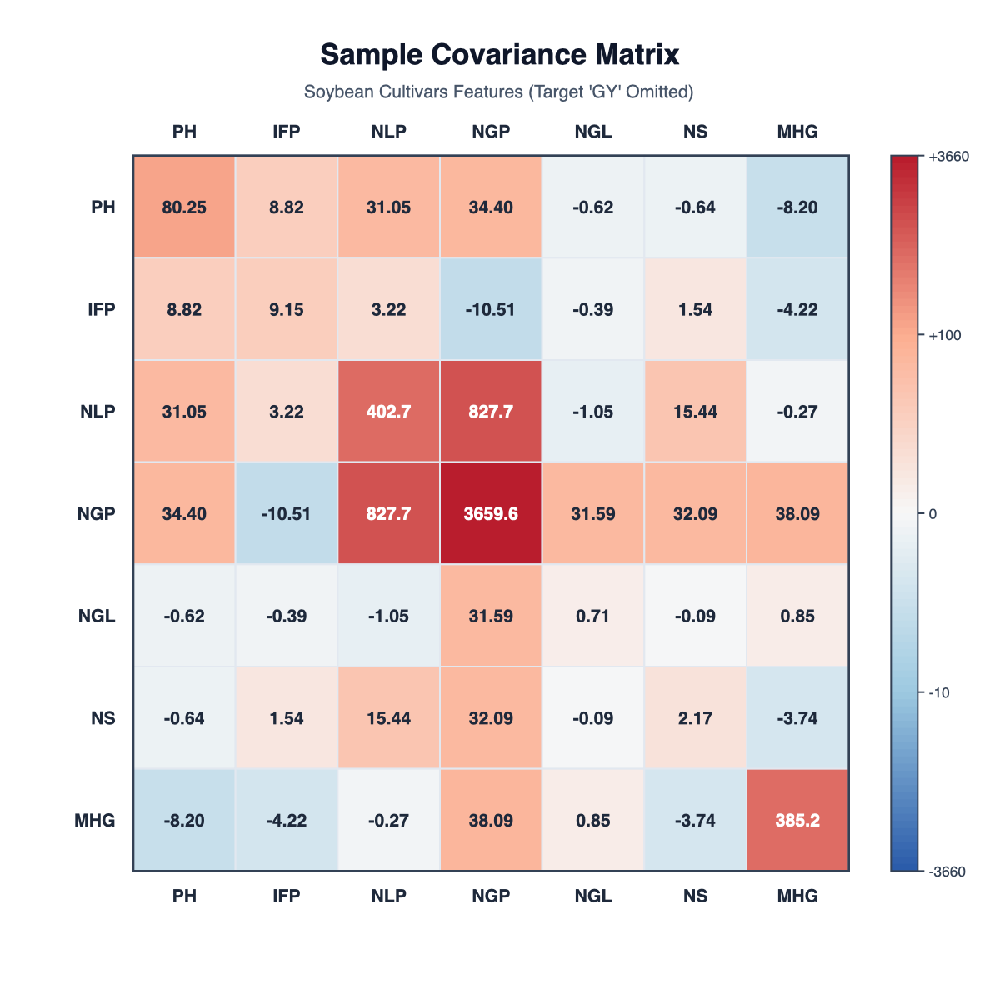
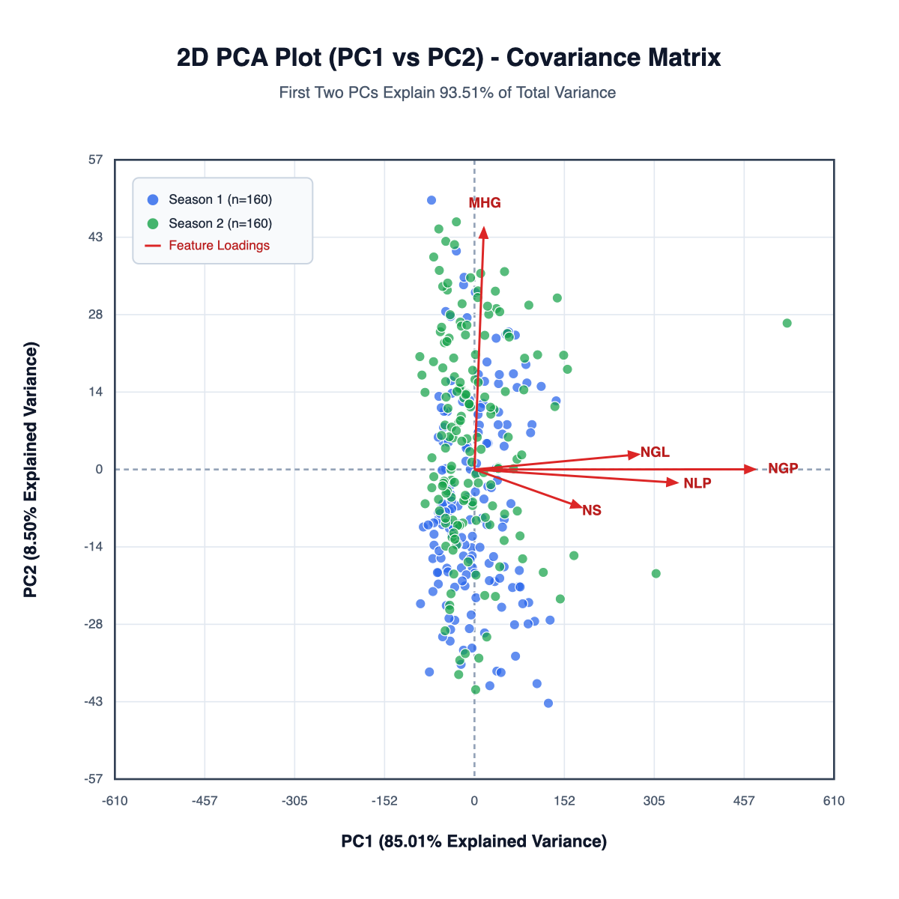
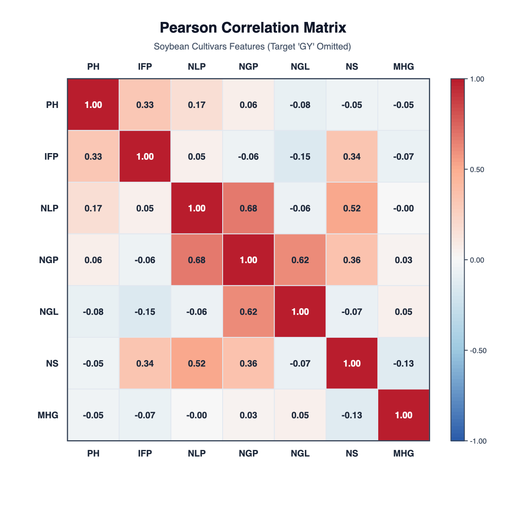
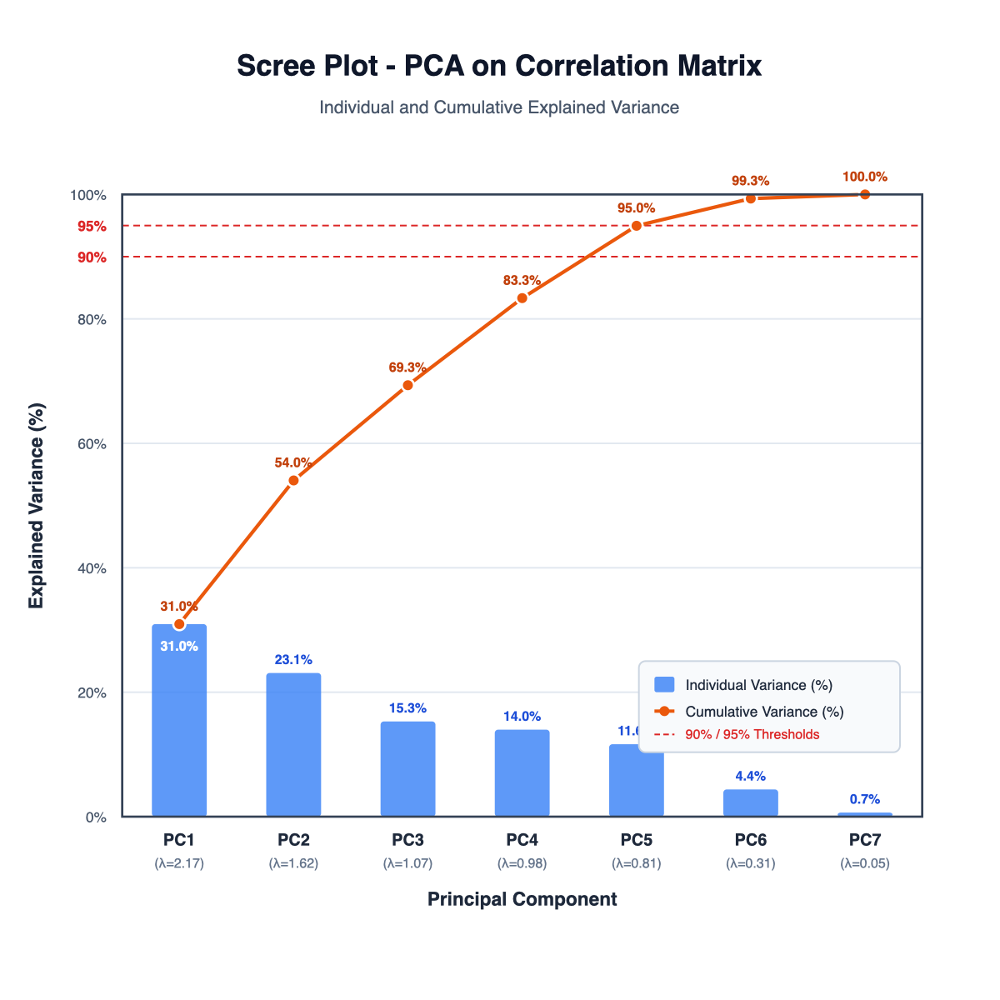
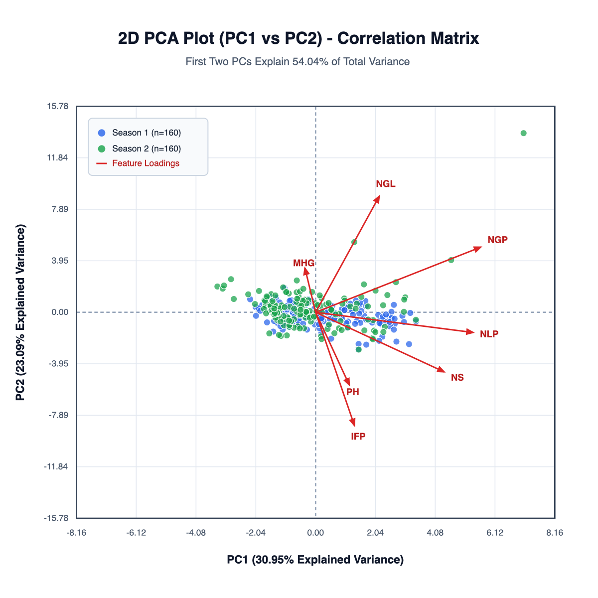

# Report 2: Dimension Reduction Methods (PCA)

## 1. Introduction and Dataset

Principal Component Analysis (PCA) is a dimension reduction method that transforms correlated variables into a smaller number of uncorrelated linear combinations called **Principal Components (PCs)**. The objective is to keep most of the variability present in the original data while reducing the number of dimensions.

The dataset used in this report is **Forty Soybean Cultivars from Subsequent Harvests** ($n = 320$ observations from 40 soybean cultivars across 2 seasons and 4 repetitions). For this analysis, the target variable **Grain Yield (`GY`)** and the identification columns (`Season`, `Cultivar`, `Repetition`) are omitted. We analyze the 7 continuous features:

| Variable | Description | Mean | Std. Dev. | Variance |
| :--- | :--- | ---: | ---: | ---: |
| **PH** | Plant Height (cm) | 68.3868 | 8.9582 | 80.2492 |
| **IFP** | Insertion of the First Pod (cm) | 15.4650 | 3.0243 | 9.1464 |
| **NLP** | Number of Pods per Plant | 59.0883 | 20.0682 | 402.7321 |
| **NGP** | Number of Grains per Plant | 135.0858 | 60.4945 | 3659.5880 |
| **NGL** | Number of Grains per Pod | 2.2908 | 0.8401 | 0.7058 |
| **NS** | Number of Stems | 4.0717 | 1.4745 | 2.1742 |
| **MHG** | Mass of a Hundred Grains (g) | 168.3223 | 19.6256 | 385.1628 |

Below we perform two separate PCA analyses: first using the **Covariance Matrix** (on centered variables $X' = X - \bar{X}$) and second using the **Correlation Matrix** (on standardized variables $X^* = \frac{X - \bar{X}}{s}$).

---

## 2. PCA Analysis Using the Covariance Matrix

### 2.1 Covariance Matrix

| | PH | IFP | NLP | NGP | NGL | NS | MHG |
| :--- | ---: | ---: | ---: | ---: | ---: | ---: | ---: |
| **PH** | 80.2492 | 8.8150 | 31.0538 | 34.3979 | -0.6168 | -0.6437 | -8.1959 |
| **IFP** | 8.8150 | 9.1464 | 3.2219 | -10.5057 | -0.3852 | 1.5356 | -4.2214 |
| **NLP** | 31.0538 | 3.2219 | 402.7321 | 827.7090 | -1.0474 | 15.4437 | -0.2707 |
| **NGP** | 34.3979 | -10.5057 | 827.7090 | 3659.5880 | 31.5865 | 32.0854 | 38.0931 |
| **NGL** | -0.6168 | -0.3852 | -1.0474 | 31.5865 | 0.7058 | -0.0911 | 0.8508 |
| **NS** | -0.6437 | 1.5356 | 15.4437 | 32.0854 | -0.0911 | 2.1742 | -3.7404 |
| **MHG** | -8.1959 | -4.2214 | -0.2707 | 38.0931 | 0.8508 | -3.7404 | 385.1628 |

### 2.2 Eigenvalues Table (Covariance Matrix)

| Component | Eigenvalue | Explained Variance (%) | Cumulative Variance (%) |
| :--- | ---: | ---: | ---: |
| **PC1** | 3859.2795 | 85.01% | 85.01% |
| **PC2** | 385.6580 | 8.50% | 93.51% |
| **PC3** | 208.4685 | 4.59% | 98.10% |
| **PC4** | 76.7777 | 1.69% | 99.79% |
| **PC5** | 8.3209 | 0.18% | 99.97% |
| **PC6** | 1.1348 | 0.02% | 100.00% |
| **PC7** | 0.1193 | 0.00% | 100.00% |
| **Total** | **4539.7587** | **100.00%** | — |

- **Number of principal components needed to account for:**
  - **a) 90% of variability:** **2 principal components** (they explain **93.51%**).
  - **b) 95% of variability:** **3 principal components** (they explain **98.10%**).
  - **c) 99% of variability:** **4 principal components** (they explain **99.79%**).
- **Percentage of variability accounted for by the first two and first three PCs:**
  - **First 2 PCs:** **93.51%**
  - **First 3 PCs:** **98.10%**

### 2.3 Scree Plot (Covariance Matrix)

### 2.4 Factor Loadings and Eigenvectors (Covariance Matrix)

#### Eigenvectors (Component Weights $e_{ik}$)

| Variable | PC1 | PC2 | PC3 | PC4 | PC5 | PC6 | PC7 |
| :--- | ---: | ---: | ---: | ---: | ---: | ---: | ---: |
| **PH** | 0.0107 | -0.0325 | 0.1676 | 0.9780 | -0.1090 | 0.0485 | 0.0010 |
| **IFP** | -0.0024 | -0.0126 | 0.0341 | 0.1126 | 0.9676 | -0.2232 | 0.0022 |
| **NLP** | 0.2330 | -0.0561 | 0.9544 | -0.1687 | -0.0229 | -0.0376 | 0.0364 |
| **NGP** | 0.9723 | 0.0030 | -0.2311 | 0.0299 | 0.0070 | -0.0009 | -0.0172 |
| **NGL** | 0.0079 | 0.0027 | -0.0403 | 0.0065 | -0.0096 | -0.0349 | 0.9985 |
| **NS** | 0.0090 | -0.0117 | 0.0342 | -0.0294 | 0.2262 | 0.9722 | 0.0377 |
| **MHG** | 0.0106 | 0.9977 | 0.0608 | 0.0233 | 0.0100 | 0.0082 | -0.0001 |

#### Factor Loadings (Correlations between Variables and PCs)

| Variable | PC1 | PC2 | PC3 | PC4 | PC5 | PC6 | PC7 |
| :--- | ---: | ---: | ---: | ---: | ---: | ---: | ---: |
| **PH** | 0.0744 | -0.0712 | 0.2702 | 0.9566 | -0.0351 | 0.0058 | 0.0000 |
| **IFP** | -0.0502 | -0.0816 | 0.1627 | 0.3263 | 0.9229 | -0.0786 | 0.0002 |
| **NLP** | 0.7211 | -0.0549 | 0.6867 | -0.0737 | -0.0033 | -0.0020 | 0.0006 |
| **NGP** | 0.9985 | 0.0010 | -0.0552 | 0.0043 | 0.0003 | 0.0000 | -0.0001 |
| **NGL** | 0.5839 | 0.0624 | -0.6921 | 0.0680 | -0.0330 | -0.0443 | 0.4104 |
| **NS** | 0.3795 | -0.1564 | 0.3344 | -0.1746 | 0.4425 | 0.7024 | 0.0088 |
| **MHG** | 0.0336 | 0.9984 | 0.0447 | 0.0104 | 0.0015 | 0.0004 | 0.0000 |

### 2.5 Equations of the First Three Principal Components (Covariance Matrix)

Using the centered variables $X'_i = X_i - \bar{X}_i$:

$$
\text{PC}_1 = 0.0107\,\text{PH}' - 0.0024\,\text{IFP}' + 0.2330\,\text{NLP}' + 0.9723\,\text{NGP}' + 0.0079\,\text{NGL}' + 0.0090\,\text{NS}' + 0.0106\,\text{MHG}'
$$

$$
\text{PC}_2 = -0.0325\,\text{PH}' - 0.0126\,\text{IFP}' - 0.0561\,\text{NLP}' + 0.0030\,\text{NGP}' + 0.0027\,\text{NGL}' - 0.0117\,\text{NS}' + 0.9977\,\text{MHG}'
$$

$$
\text{PC}_3 = 0.1676\,\text{PH}' + 0.0341\,\text{IFP}' + 0.9544\,\text{NLP}' - 0.2311\,\text{NGP}' - 0.0403\,\text{NGL}' + 0.0342\,\text{NS}' + 0.0608\,\text{MHG}'
$$

### 2.6 2D and 3D Plots (Covariance Matrix)

### 2.7 Interpretation (Covariance Matrix PCA)

In the covariance matrix approach, the variables are not scaled to unit variance. Because `NGP` (Number of Grains per Plant) has a variance of $3659.59$ out of the total variance of $4539.76$ ($80.6\%$), **PC1 (85.01%)** is almost completely dominated by `NGP` (weight $0.9723$, correlation loading $0.9985$) and `NLP` (loading $0.7211$). **PC2 (8.50%)** corresponds almost entirely to `MHG` (Mass of 100 Grains, weight $0.9977$, loading $0.9984$), while **PC3 (4.59%)** reflects the remaining variation in `NLP` (weight $0.9544$). Variables with small numeric values such as `NGL`, `NS`, and `IFP` have almost no influence on the first three components simply because their measurement units give small variance values.

---

## 3. PCA Analysis Using the Correlation Matrix

### 3.1 Correlation Matrix

| | PH | IFP | NLP | NGP | NGL | NS | MHG |
| :--- | ---: | ---: | ---: | ---: | ---: | ---: | ---: |
| **PH** | 1.0000 | 0.3254 | 0.1727 | 0.0635 | -0.0820 | -0.0487 | -0.0466 |
| **IFP** | 0.3254 | 1.0000 | 0.0531 | -0.0574 | -0.1516 | 0.3444 | -0.0711 |
| **NLP** | 0.1727 | 0.0531 | 1.0000 | 0.6818 | -0.0621 | 0.5219 | -0.0007 |
| **NGP** | 0.0635 | -0.0574 | 0.6818 | 1.0000 | 0.6215 | 0.3597 | 0.0321 |
| **NGL** | -0.0820 | -0.1516 | -0.0621 | 0.6215 | 1.0000 | -0.0736 | 0.0516 |
| **NS** | -0.0487 | 0.3444 | 0.5219 | 0.3597 | -0.0736 | 1.0000 | -0.1293 |
| **MHG** | -0.0466 | -0.0711 | -0.0007 | 0.0321 | 0.0516 | -0.1293 | 1.0000 |

### 3.2 Eigenvalues Table (Correlation Matrix)

| Component | Eigenvalue | Explained Variance (%) | Cumulative Variance (%) |
| :--- | ---: | ---: | ---: |
| **PC1** | 2.1666 | 30.95% | 30.95% |
| **PC2** | 1.6165 | 23.09% | 54.04% |
| **PC3** | 1.0712 | 15.30% | 69.35% |
| **PC4** | 0.9789 | 13.98% | 83.33% |
| **PC5** | 0.8147 | 11.64% | 94.97% |
| **PC6** | 0.3063 | 4.38% | 99.35% |
| **PC7** | 0.0458 | 0.65% | 100.00% |
| **Total** | **7.0000** | **100.00%** | — |

- **Number of principal components needed to account for:**
  - **a) 90% of variability:** **5 principal components** (they explain **94.97%**).
  - **b) 95% of variability:** **6 principal components** (they explain **99.35%**).
  - **c) 99% of variability:** **6 principal components** (they explain **99.35%**).
- **Percentage of variability accounted for by the first two and first three PCs:**
  - **First 2 PCs:** **54.04%**
  - **First 3 PCs:** **69.35%**

### 3.3 Scree Plot (Correlation Matrix)

### 3.4 Factor Loadings and Eigenvectors (Correlation Matrix)

#### Eigenvectors (Component Weights $e_{ik}$)

| Variable | PC1 | PC2 | PC3 | PC4 | PC5 | PC6 | PC7 |
| :--- | ---: | ---: | ---: | ---: | ---: | ---: | ---: |
| **PH** | 0.1227 | -0.3560 | 0.7421 | -0.0686 | -0.3849 | 0.3932 | 0.0080 |
| **IFP** | 0.1412 | -0.5538 | 0.2700 | -0.0669 | 0.6209 | -0.4587 | -0.0053 |
| **NLP** | 0.5733 | -0.0990 | -0.1316 | 0.2479 | -0.4127 | -0.3701 | -0.5248 |
| **NGP** | 0.6016 | 0.3192 | 0.1175 | -0.0569 | -0.0366 | -0.1805 | 0.6966 |
| **NGL** | 0.2317 | 0.5682 | 0.3275 | -0.3465 | 0.3717 | 0.1373 | -0.4889 |
| **NS** | 0.4682 | -0.2919 | -0.4052 | 0.0538 | 0.3032 | 0.6607 | -0.0107 |
| **MHG** | -0.0389 | 0.2163 | 0.2718 | 0.8962 | 0.2542 | 0.1003 | 0.0012 |

#### Factor Loadings (Correlations between Variables and PCs)

| Variable | PC1 | PC2 | PC3 | PC4 | PC5 | PC6 | PC7 |
| :--- | ---: | ---: | ---: | ---: | ---: | ---: | ---: |
| **PH** | 0.1806 | -0.4526 | 0.7680 | -0.0679 | -0.3474 | 0.2176 | 0.0017 |
| **IFP** | 0.2078 | -0.7042 | 0.2794 | -0.0662 | 0.5604 | -0.2539 | -0.0011 |
| **NLP** | 0.8439 | -0.1259 | -0.1362 | 0.2452 | -0.3725 | -0.2049 | -0.1123 |
| **NGP** | 0.8854 | 0.4059 | 0.1216 | -0.0563 | -0.0330 | -0.0999 | 0.1490 |
| **NGL** | 0.3411 | 0.7224 | 0.3389 | -0.3429 | 0.3355 | 0.0760 | -0.1046 |
| **NS** | 0.6892 | -0.3711 | -0.4194 | 0.0532 | 0.2736 | 0.3657 | -0.0023 |
| **MHG** | -0.0573 | 0.2750 | 0.2813 | 0.8867 | 0.2295 | 0.0555 | 0.0003 |

### 3.5 Equations of the First Three Principal Components (Correlation Matrix)

Using the standardized variables $X^*_i = \frac{X_i - \bar{X}_i}{s_i}$:

$$
\text{PC}_1 = 0.1227\,\text{PH}^* + 0.1412\,\text{IFP}^* + 0.5733\,\text{NLP}^* + 0.6016\,\text{NGP}^* + 0.2317\,\text{NGL}^* + 0.4682\,\text{NS}^* - 0.0389\,\text{MHG}^*
$$

$$
\text{PC}_2 = -0.3560\,\text{PH}^* - 0.5538\,\text{IFP}^* - 0.0990\,\text{NLP}^* + 0.3192\,\text{NGP}^* + 0.5682\,\text{NGL}^* - 0.2919\,\text{NS}^* + 0.2163\,\text{MHG}^*
$$

$$
\text{PC}_3 = 0.7421\,\text{PH}^* + 0.2700\,\text{IFP}^* - 0.1316\,\text{NLP}^* + 0.1175\,\text{NGP}^* + 0.3275\,\text{NGL}^* - 0.4052\,\text{NS}^* + 0.2718\,\text{MHG}^*
$$

### 3.6 2D and 3D Plots (Correlation Matrix)

### 3.7 Interpretation (Correlation Matrix PCA)

When we standardize the data, all 7 features contribute equally (variance $= 1.0$ each):
- **PC1 (30.95% of variance)** has strong positive loadings with `NGP` ($0.8854$), `NLP` ($0.8439$), and `NS` ($0.6892$). It represents the **overall pod and grain production per plant**. In the 2D plot, Season 1 plants generally score higher on PC1 than Season 2 plants.
- **PC2 (23.09% of variance)** has a high positive loading on `NGL` ($0.7224$) and a strong negative loading on `IFP` ($-0.7042$) and `PH` ($-0.4526$). It contrasts **grains per pod against first pod height and plant height**.
- **PC3 (15.30% of variance)** is mainly driven by `PH` ($0.7680$) versus `NS` ($-0.4194$), separating tall plants with fewer stems from shorter, branched plants.
- **PC4 (13.98% of variance)** is dominated by `MHG` ($0.8867$), showing that hundred-grain weight varies almost independently from the number of pods or stems.
- **PC7 (0.65% of variance)** is almost zero ($\lambda_7 = 0.0458$) because `NGP` is mathematically redundant with `NLP` and `NGL` ($\text{NGP} \approx \text{NLP} \times \text{NGL}$), which allows 6 components to explain **99.35%** of the total variance.

---

## 4. Conclusions

| Summary Metric | Covariance Matrix PCA | Correlation Matrix PCA |
| :--- | :--- | :--- |
| **Variance of First 2 PCs** | 93.51% | 54.04% |
| **Variance of First 3 PCs** | 98.10% | 69.35% |
| **Components for 90% Variance** | 2 PCs (93.51%) | 5 PCs (94.97%) |
| **Components for 95% Variance** | 3 PCs (98.10%) | 6 PCs (99.35%) |
| **Components for 99% Variance** | 4 PCs (99.79%) | 6 PCs (99.35%) |

1. **Effect of Scale Differences:** In the Covariance Matrix PCA, the results are heavily biased by the measurement scale of `NGP` (variance $3659.59$), `NLP` ($402.73$), and `MHG` ($385.16$). As a result, just 2 components appear to explain $93.51\%$ of the variance, while smaller-scale variables like `NGL` and `NS` are ignored.
2. **Advantage of Correlation Matrix PCA:** Because the 7 agronomic variables are measured in different units (cm, counts, ratios, grams) with very different magnitudes, **PCA on the Correlation Matrix is the appropriate choice**. It gives equal importance to all features and identifies meaningful biological components (plant productivity in PC1, pod fertility vs. pod height in PC2, plant height vs. branching in PC3, and grain weight in PC4).
